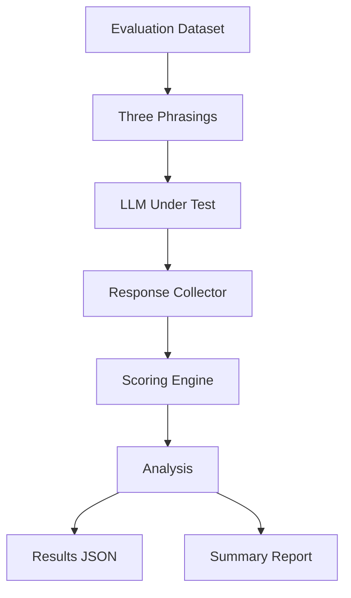

# LLM Evaluation Harness to Measure Model Reliability

## Overview

This project implements a robust LLM evaluation harness designed to benchmark the reliability of Large Language Models (LLMs) by measuring their consistency across semantically equivalent but differently phrased questions. It automates the process of sending prompts to an LLM, collecting responses, scoring them using multiple strategies, and generating comprehensive reports.

## Architecture

The evaluation process follows a clear, modular architecture:



## Dataset

The `dataset/evaluation_dataset.json` file contains a collection of at least 20 unique questions (currently 25) designed for objective evaluation. Each question includes:
- A canonical `question_text`.
- An `id` for unique identification.
- An objectively verifiable `correct_answer`.
- A `category` (e.g., geography, arithmetic, logic).
- A `difficulty` level (easy, medium, hard).
- A `scoring_strategy` to specify which scorer to use.
- Exactly three `phrasings` of the same question, varying in structure and wording to test phrasing sensitivity.

The dataset focuses on objective-answer domains to ensure reliable automated evaluation.

## Scoring Strategies

The harness employs at least two independent scoring strategies to determine the correctness of LLM responses:

1.  **`normalized_exact_match`**: This strategy performs extensive normalization on both the LLM's response and the `correct_answer`. It handles case insensitivity, strips whitespace, normalizes punctuation, and attempts to remove harmless surrounding phrases (e.g., "The answer is X"). It is robust to minor variations in phrasing and formatting, including numeric answers.

2.  **`regex_extraction`**: This strategy uses regular expressions to extract specific answer patterns from the LLM's response. It is particularly useful for multiple-choice questions, specific numeric answers, or short factual answers where the expected format is more structured (e.g., "The correct answer is B.", "The answer is Canberra.", "Therefore, the result is 42."). The extracted answer is then compared to the `correct_answer`.

Both strategies return `1` for a correct answer and `0` for an incorrect answer.

## Metrics

The evaluation harness calculates several key metrics to provide a comprehensive understanding of LLM performance and reliability:

-   **Overall Accuracy**: The total number of correct responses divided by the total number of evaluations across all questions and phrasings.
-   **Category Accuracy**: Accuracy grouped by the `category` of the questions (e.g., geography, science).
-   **Difficulty Accuracy**: Accuracy grouped by the `difficulty` level of the questions (easy, medium, hard).
-   **Phrasing Accuracy**: Separate accuracy scores for each of the three phrasing styles (phrasing 1, phrasing 2, phrasing 3), revealing if certain phrasing structures consistently perform better or worse.
-   **Phrasing Sensitivity**: Measured as the population standard deviation of the three binary scores (0 or 1) for each question. A higher standard deviation indicates greater sensitivity to phrasing variations for that specific question.
-   **Per-Question Accuracy**: The accuracy for each individual question across its three phrasings.
-   **Most Frequently Failed Questions**: A list of questions that had the highest number of incorrect responses across their phrasings.

## Project Structure

```
llm-evaluation-harness/
│
├── .env.example
├── .gitignore
├── Dockerfile
├── docker-compose.yml
├── README.md
├── requirements.txt
│
├── dataset/
│   └── evaluation_dataset.json
│
├── src/
│   ├── __init__.py
│   ├── llm_client.py
│   ├── scorers.py
│   ├── runner.py
│   └── analysis.py
│
├── scripts/
│   └── run_evaluation.py
│
├── results/
│   ├── evaluation_results.json
│   └── summary_report.md
│
└── tests/
    ├── __init__.py
    └── test_scoring.py
```

## Local Setup

To set up and run the evaluation harness locally:

1.  **Clone the repository:**
    ```bash
    git clone https://github.com/your-username/llm-evaluation-harness.git
    cd llm-evaluation-harness
    ```

2.  **Create a Python virtual environment (Windows CMD):**
    ```cmd
    python -m venv .venv
    .venv\Scripts\activate
    ```
    *(For macOS/Linux, use `python3 -m venv .venv` and `source .venv/bin/activate`)*

3.  **Install dependencies:**
    ```bash
    pip install -r requirements.txt
    ```

4.  **Configure API Key:**
    Copy the `.env.example` file to `.env` and replace `your_openai_api_key` with your actual OpenAI API key.
    ```bash
    cp .env.example .env
    # Then open .env in a text editor and update OPENAI_API_KEY
    ```
    **CRITICAL:** Never commit your `.env` file with your actual API key to version control. It is already ignored by `.gitignore`.

## Run Tests

To ensure the scoring logic and dataset validation are working correctly without requiring an LLM API key:

```bash
python -m pytest tests -v
```

## Run Evaluation

To execute the full evaluation pipeline against the configured LLM:

```bash
python -m scripts.run_evaluation
```
This command will load the dataset, send prompts to the LLM, score responses, and generate the `evaluation_results.json` and `summary_report.md` files in the `results/` directory.

## Docker

For a reproducible evaluation environment using Docker:

1.  **Build the Docker image:**
    ```bash
    docker compose build
    ```

2.  **Run the evaluation using Docker Compose:**
    ```bash
    docker compose run --rm eval-runner
    ```
    This will execute the evaluation within a Docker container. The results will be mounted back to your local `results/` directory.

3.  **Run tests using Docker Compose:**
    ```bash
    docker compose run --rm eval-runner pytest
    ```

## Output Files

After running the evaluation, two key output files will be generated in the `results/` directory:

-   **`evaluation_results.json`**: This file contains the raw, detailed records of each individual evaluation, including the question ID, phrasing, model response, correct answer, score, and scoring strategy. It also includes aggregated metadata and analysis results.
-   **`summary_report.md`**: A human-readable Markdown report summarizing the evaluation findings, including overall accuracy, accuracy breakdowns by category and difficulty, per-question results, phrasing sensitivity analysis, and key insights.

## Reproducibility

The evaluation harness is designed for reproducibility:
-   **Fixed Dataset**: The `evaluation_dataset.json` is static and version-controlled.
-   **Temperature=0**: The LLM client is configured with `temperature=0` to minimize randomness in model responses.
-   **Deterministic Scoring**: Both scoring strategies are deterministic, ensuring consistent scoring for identical responses.
-   **Docker**: The Docker setup provides a consistent execution environment, isolating dependencies and system configurations.

## Limitations

While comprehensive, this evaluation harness has inherent limitations:
-   **LLM Response Variability**: Even with `temperature=0`, LLMs can exhibit some non-determinism, leading to slight variations in responses across runs.
-   **Automated Scoring Limitations**: Automated scoring, especially for natural language, can never be 100% perfect. Complex or nuanced answers might be incorrectly scored by deterministic strategies. The chosen objective domains mitigate this risk.
-   **Phrasing Sample Size**: Three phrasings per question provide a good sample for robustness, but it is still a small subset of all possible ways to phrase a question. A model might be sensitive to other phrasings not included.
-   **Objective Datasets**: While beneficial for automated scoring, relying solely on objective datasets might not fully capture an LLM's performance on more subjective or open-ended tasks.
